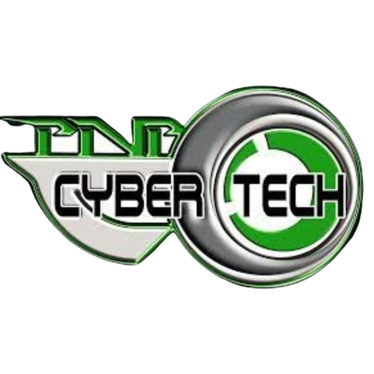

<p align="center"></p>

# UKM Cybertech Official Website

Selamat datang di repositori laman web resmi Unit Kegiatan Mahasiswa (UKM) Cybertech. Website ini dibangun menggunakan framework Laravel dan Vite untuk menyediakan informasi dan aktivitas terkini dari UKM Cybertech.

## Fitur Utama

- **Beranda Dinamis**: Menampilkan informasi terbaru tentang UKM Cybertech.
- **Info Event**: Informasi seputar event apa saja yang cybertecha adakan.
- **Formulir Pendaftaran**: Pendaftaran untuk event secara online.
- **Galeri Media**: Koleksi media kegiatan UKM.
- **Member Managenet**: Pengelolaan keanggotaan oleh admin, yang akan emnampilkan jajaran kepengurusna secara dinamis.

## Instalasi

Ikuti langkah-langkah berikut untuk menjalankan proyek ini secara lokal:

1. Clone repositori ini:
   ```bash
   git clone https://github.com/Baghaztra/Cybertech.git
   ```

2. Masuk ke direktori proyek:
   ```bash
   cd Cybertech
   ```

3. Instal dependensi untuk Laravel:
   ```bash
   composer install
   ```

4. Install depedensi untuk Vite:
   ```bash
   npm install
   ```

5. Migrasikan database:
   ```bash
   php artisan migrate --seed
   ```

6. Jalankan server vite:
   ```bash
   npm run dev
   ```

7. Jalankan server laravel (di terminal berbeda):
   ```bash
   php artisan serve
   ```

Akses website di `http://localhost:8000`.

## Struktur Direktori Penting

- `app/` - Berisi logika aplikasi.
- `resources/views/` - Template untuk tampilan website.
- `public/assets/` - Berisi file statis seperti logo, gambar, dan stylesheet.

## Kontribusi

Kami sangat terbuka terhadap kontribusi dari siapa saja. Jika Anda menemukan masalah atau memiliki ide fitur baru, silakan buat [issue](https://github.com/Baghaztra/Cybertech/issues) atau ajukan pull request.

## Lisensi

Proyek ini dilisensikan di bawah [MIT License](https://opensource.org/licenses/MIT).

---

<p align="center">Dikembangkan dengan ❤️ oleh UKM Cybertech</p>
